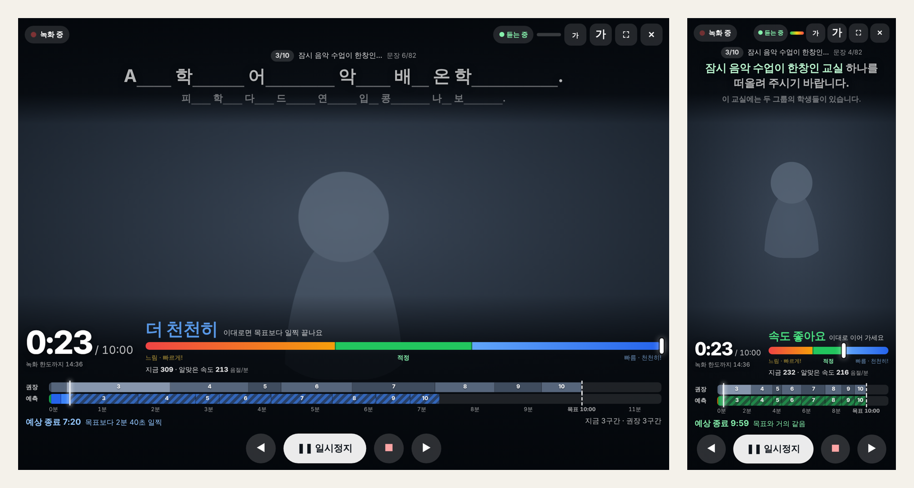

# BRIDGE 발표 리허설

원고 없이 하는 발표를 위한 촬영 연습 웹앱입니다. 휴대폰·태블릿·PC에서 같은 주소로 열어 씁니다.

- 화면 가득 **내 모습**(전면 카메라, 거울 보기)
- 화면 위쪽(카메라 가까이) **원고 자막** — 말하면 그 부분의 색이 바뀝니다 (흰색 → 연초록 → 초록)
- **러닝타임** — 목표 시간(기본 10:00)에서 0:00으로 거꾸로 세는 남은 시간 / 목표 시간 / 녹화 한도(15분)까지 남은 시간. 0:00을 넘기면 빨간 글씨로 +초과 시간
- **속도계** — 바늘과 큰 글씨로 "더 천천히 · 조금 천천히 · 속도 좋아요 · 조금 빠르게 · 더 빠르게"를 바로 알려 줍니다
- **타임라인 가로 막대 2줄** — 구간별 *권장 시간* 과 지금 속도로 계산한 *예측 시간* 을 같은 시간축에 색을 달리해 비교
- 녹화 영상 다시 보기, 문장별 기록, 영상 파일 저장



빌드나 설치가 필요 없습니다. 이 폴더를 GitHub에 올리고 GitHub Pages를 켜면 끝입니다.

---

## 1. GitHub에 올리기 (git 없이 웹에서)

1. GitHub에 로그인 → 오른쪽 위 **＋ → New repository**
   - Repository name: 예) `rehearsal`
   - **Public** 선택 (무료 계정의 GitHub Pages는 공개 저장소에서 동작합니다)
   - **Create repository**
2. 새 저장소 화면에서 **uploading an existing file** 클릭
3. 압축을 푼 폴더 **안의 파일과 폴더 전체**(`index.html`, `css`, `js`, `docs`, `tests` …)를 끌어다 놓기 → **Commit changes**
   - 폴더 자체가 아니라 *폴더 안의 내용* 을 올려야 `index.html`이 저장소 맨 위에 놓입니다.
   - 숨김 파일 `.nojekyll`, `.gitignore`는 빠져도 동작에 문제없습니다.
4. 저장소 **Settings → Pages**
   - Source: **Deploy from a branch**
   - Branch: **main** / **(root)** → **Save**
5. 1~2분 뒤 같은 화면 위쪽에 주소가 나타납니다.
   `https://<GitHub 아이디>.github.io/<저장소 이름>/`
6. 휴대폰·태블릿에서 그 주소를 열고, 브라우저 메뉴의 **홈 화면에 추가**를 누르면 앱처럼 실행됩니다.

> 원고 공개 주의: 공개 저장소에 올린 `sample-script.txt`는 누구나 볼 수 있습니다. 원고를 공개하고 싶지 않다면 이 파일의 내용을 지우고 올린 뒤, 앱에서 원고를 직접 붙여넣으세요. 붙여넣은 원고는 그 기기에만 저장됩니다.

수정한 파일을 다시 올릴 때도 3번처럼 끌어다 놓으면 같은 이름의 파일이 바뀝니다.

## 2. 사용 순서

1. **원고** — 붙여넣거나 *예시 원고* / *파일 열기*. `=====` 줄로 구간을 나누고, `=== 첫 번째 다리`처럼 쓰면 구간 이름이 됩니다. 넣자마자 구간·문장·음절 수와 예상 시간, 권장 배분 막대가 나옵니다.
2. **시간** — 목표 시간(기본 10분). 최대 녹화는 15분입니다(일시정지 제외, 14분·14분 30초에 안내, 15분에 자동 저장·종료). 구간별 권장 시간은 음절 수에 맞춰 자동 배분되며 직접 고칠 수 있습니다.
3. **자막과 추적**
   - 자막 보기: **전체** → **첫 글자** → **숨김**(말한 부분만 드러남)
   - 위치 따라가기
     - **음성 인식**: 말을 알아듣고 정확히 따라갑니다. **인식된 곳만** 색이 바뀝니다. 문장 끝이 인식된 뒤 잠깐 쉬면 바로 다음 문장으로 넘어갑니다. 인식 결과가 12초 넘게 없으면 목소리로 위치를 추정해 파란 밑줄로 보여 줍니다.
     - **음성 감지**: 인식 없이 목소리가 나는 동안 자막을 채우고, 말을 쉬면 다음 문장으로 넘어갑니다. 어느 기기에서나, 인터넷 없이도 끊기지 않습니다(위치는 추정).
     - **탭해서 넘기기**: 말하는 동안 문장이 채워지고, 다 말하면 자막을 탭하거나 ▶, 키보드 →, 프레젠터로 넘깁니다.
4. **카메라 켜고 연습 화면으로** → **● 녹화 시작** → 3초 카운트다운 → 발표
5. **■** 를 누르면 저장되고 결과 화면이 열립니다. 영상 재생, 구간별 시간, 문장별 기록(누르면 그 장면으로 이동), **영상 저장**.

### 원고 없이 말하기까지 권장 순서

| 단계 | 설정 | 목적 |
|---|---|---|
| 1 | 전체 + 음성 인식 | 흐름과 시간 감각 잡기 (2~3회) |
| 2 | 첫 글자 + 음성 인식 | 어절 첫 글자만 보고 말하기 |
| 3 | 숨김 + 음성 인식 | 말한 부분만 드러남. 4초 막히면 다음 어절을 흐리게 보여 줌 |
| 4 | 숨김 + 탭해서 넘기기 | 실전처럼 멈추지 않고 끝까지 |

### 속도계 보는 법

속도계는 **지금 속도(최근 20초)** 를 **목표 시간에 딱 맞게 끝내려면 필요한 속도** 와 비교합니다.

| 바늘 위치 | 큰 글씨 | 할 일 |
|---|---|---|
| 오른쪽 파랑 | 더 천천히 / 조금 천천히 | 이대로면 일찍 끝납니다. 숨을 고르고 쉼을 두세요 |
| 가운데 초록 | 속도 좋아요 | 그대로 이어 가세요 |
| 왼쪽 주황·빨강 | 조금 빠르게 / 더 빠르게 | 이대로면 시간을 넘깁니다 |

녹화 전에는 "목표 10:00에 맞추려면 분당 ○○○음절"을 보여 줍니다. 앞서 가면 필요한 속도가 낮아지고 뒤처지면 높아지므로, 같은 속도라도 진행 상황에 따라 안내가 달라집니다.

### 화면 읽는 법

| 표시 | 뜻 |
|---|---|
| 자막 흰색 | 아직 말하지 않은 부분 |
| 자막 연초록 | 인식 중(잠정 결과) · 음성 감지 모드에서는 말하는 중 |
| 파란 밑줄 | 음성 인식 결과가 없어 목소리로 추정한 위치 |
| 자막 초록 | 말함(확정) |
| 자막 주황 점선 | 지나갔지만 인식되지 않은 부분 |
| 권장 막대(회색) | 구간별 권장 시간. 밝은 칸 = 지금 시각에 있어야 할 구간 |
| 예측 막대 | 지난 구간 실제 시간(파랑 빠름·초록 적정·주황 느림) + 남은 구간 예측(빗금) |
| 흰 세로선 / 점선 | 지금 시각 / 목표 시각 |
| 붉은 영역 | 목표 시간을 넘길 것으로 예측되는 부분 |
| 예상 종료 문구 | "목표보다 38초 늦게", "2분 47초 일찍"처럼 말로 표시 |

## 3. 기기별 안내

| 기기 | 권장 브라우저 | 참고 |
|---|---|---|
| PC·노트북 + 웹캠 | Chrome, Edge | 모든 기능. 프레젠터(→/PageDown)로 문장 넘기기 |
| 안드로이드 태블릿·휴대폰 | Chrome | 음성 인식이 끊기는 동안에도 목소리 감지로 자막이 이어집니다. 처음부터 인식이 안 되는 기기는 자동으로 *음성 감지* 로 바뀌고 녹화는 계속됩니다 |
| 아이패드·아이폰 | Safari | 녹화·타이머·막대 정상. 음성 인식이 자주 끊기므로 **음성 감지** 를 권장. 영상은 결과 화면 **공유 → 비디오 저장** 으로 사진 앱에 저장 |

- 카메라·마이크는 **https 주소**에서만 켜집니다. `index.html`을 더블클릭해서 열면 카메라와 예시 원고가 동작하지 않습니다.
- 음성 인식은 인터넷 연결이 필요할 수 있습니다. 학교망에서 막히면 *음성 감지* 로 연습하세요.
- Chrome 최신 버전은 설정의 **기기 안 음성 인식** 을 켜면 인터넷 없이 이 기기에서 처리합니다(실험 기능).
- 서서 발표할 때는 기기를 거치대에 두고 1.5~2m 떨어져 보세요. 상단 **가 / 가** 버튼으로 자막 크기를 바꿉니다.

## 4. 영상과 기록은 어디에 저장되나요?

- 이 기기의 이 브라우저 안(IndexedDB)에만 저장됩니다. 서버나 GitHub로 올라가지 않습니다.
- 브라우저 데이터를 지우면 영상도 지워집니다. 중요한 영상은 결과 화면의 **영상 저장** 으로 파일을 받아 두세요.
- 다른 기기·다른 브라우저와는 자동으로 공유되지 않습니다.
- 브라우저 음성 인식은 브라우저 제공 회사의 서버에서 음성을 처리할 수 있습니다.
- 녹화 화질(15분 기준): 절약 약 90MB · 표준 약 180MB · 고화질 약 350MB

## 5. 파일 구조

```
├── index.html            화면(준비·연습·결과)
├── css/style.css         반응형 스타일
├── js/
│   ├── core.js           원고 분할·발음 정규화·위치 추적·시간 예측 (순수 로직)
│   ├── speech.js         브라우저 음성 인식(자동 재연결)
│   ├── recorder.js       카메라·녹화·마이크 레벨·화면 꺼짐 방지
│   ├── storage.js        기기 저장소(IndexedDB)
│   └── app.js            화면과 흐름
├── sample-script.txt     예시 원고
├── manifest.webmanifest  홈 화면에 추가용
├── icon.svg, icon-180.png, icon-512.png
├── docs/PRD.md           제품 요구사항 문서
├── docs/preview.png
└── tests/core.test.mjs   자동 테스트
```

## 6. 내 PC에서 실행·테스트 (선택)

```sh
# 폴더 안에서 간단한 웹서버 실행 → http://localhost:8080
python -m http.server 8080

# 핵심 로직 자동 테스트 (Node.js 20 이상)
node --test tests/core.test.mjs
```

localhost 주소에서는 카메라가 동작합니다. 휴대폰에서 PC의 `http://192.168…` 주소로 접속하면 https가 아니어서 카메라가 켜지지 않습니다. 휴대폰 테스트는 GitHub Pages 주소로 하세요.

## 7. 알려진 제한

- 음성 인식 정확도와 반응 속도는 브라우저·기기·네트워크에 따라 다릅니다. 어긋나면 ◀ ▶로 바로잡으세요.
- 음성 인식이 잠시 멈추면 앱이 알아서 다시 연결하고, 그동안 자막은 목소리 감지로 이어집니다(상태 칩: "목소리로 잇는 중"). 다시 켤 수 없는 상태면 칩에 "인식 꺼짐 · 눌러서 켜기"가 뜹니다. 자막이나 칩을 누르면 다시 켜집니다.
- 음성 감지는 목소리와 쉼으로 위치를 추정합니다. 문장 사이에서 한 문장 앞서거나 늦을 수 있으니 ◀ ▶로 맞춰 주세요. 결과 화면에서는 "추정"으로 표시됩니다.
- 문제가 계속되면 결과 화면의 **기록 JSON** 에 음성 인식 오류 기록(asr-error 등)이 남습니다.
- 자막·타이머는 화면에만 표시되고 영상 파일에는 들어가지 않습니다(결과 화면에서 원고와 함께 다시 볼 수 있습니다).
- 문장 판정은 음절 일치율 기준입니다. 원고와 다른 표현으로 바꿔 말하면 "일부"나 "누락"으로 보일 수 있습니다.

자세한 요구사항과 알고리즘은 [docs/PRD.md](docs/PRD.md)를 참고하세요.
